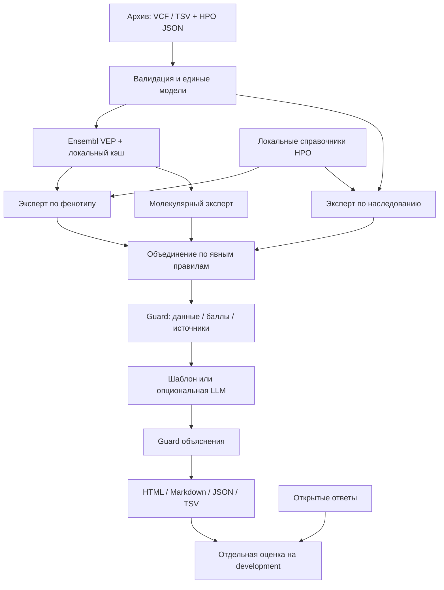

# Геномный детектив

Рабочий исследовательский прототип для кейса 3 «СИНТЕЗ». Принимает предоставленный архив с VCF/TSV и HPO-профилями, получает аннотации, ранжирует варианты и гены и сохраняет объяснимый отчёт.

Это один Python-проект с тремя детерминированными экспертными модулями. Оркестратор реализован кодом. Опциональная LLM выбирает факты для объяснения после расчёта; она не меняет баллы и кандидатов. Модули не выдаются за автономных LLM-агентов.

Текущая версия правил — **v1.2**: молекулярные доказательства сопоставляются с конкретным заболеванием, точным аллелем и транскриптом. VUS, конфликты и неподдерживаемые категории не добавляют клиническую поддержку; неизвестность не означает доброкачественность. [Изменения и проверка v1.2](docs/model_v1_2_validation.md), [план до защиты](docs/next_steps.md).

**Новая проверка:** [96 контрольных запусков и внешний пилот на 20 случаях](docs/validation_results_v1.md). Top-1 v1.2 — 19/20 на внешнем полусинтетическом наборе; при удалении известного причинного варианта из шести исходных случаев статус `candidate` всё равно выдаётся 6/6 раз. Полной независимости от HPO/ClinVar нет. Это исследовательская приоритизация, а не клиническая точность. Повторение без API: `.\validate.ps1 -External --bundled --output outputs/external_replay --expect validation/results/external-v1.json`.

Предметный разбор: [19 источников, шесть вариантов, правила и контрольные примеры](docs/molecular_evidence_review.md). Исследовательские карточки `config/molecular_evidence.research.json` не загружаются напрямую. Ограниченный набор применимых правил перенесён в `config/molecular_knowledge.json`; клинический снимок находится в `resources/clinvar-snapshot.json`.

## Быстрый запуск

### Windows — скачать и открыть

1. На GitHub нажать **Code → Download ZIP** либо клонировать репозиторий.
2. **Полностью распаковать** ZIP в обычную папку.
3. Дважды нажать **`Start.cmd`** и оставить появившееся окно открытым.

Лаунчер найдёт Python **3.11+**. Если его нет, на Windows x64 сам распакует включённый в репозиторий официальный переносимый Python в `.runtime/` с проверкой SHA-256. **На Windows x64 интернет после скачивания репозитория не нужен**, даже если Python не установлен. Права администратора и настройка PATH не нужны. На Windows ARM64/32-bit без установленного Python подходящий runtime автоматически скачивается с python.org; для этого нужен интернет.

Аннотации десяти случаев и HPO уже включены в репозиторий в `resources/demo-data.zip` (около 10 МБ). Первый запуск проверит и распакует их, затем загрузит справочники и откроет браузер. Подготовка может занять несколько десятков секунд. **API-ключ, аккаунт GigaChat, Codex и pip install для интерфейса не требуются.** Внешних Python-зависимостей нет.

### macOS / Linux

Нужен установленный **Python 3.11+** со стандартными модулями sqlite3 и ssl. Из распакованной папки:

```sh
sh start.sh
```

Справочники и аннотации также распакуются из репозитория, без скачивания. Если Python отсутствует, установите его с [python.org](https://www.python.org/downloads/) или через пакетный менеджер своей ОС. Автоматическая загрузка переносимого интерпретатора реализована для Windows.

### Управление запуском

В PowerShell с установленным или уже загруженным Python:

```powershell
.\run.ps1 serve --open
```

Адрес: **http://127.0.0.1:8765**. Остановка — `Ctrl+C` в терминале. Интерфейс использует локальный кэш и не выполняет внешние запросы. При занятом порте откройте уже запущенный экземпляр либо используйте `Start.cmd --port 8766`. Данные и источники: [resources/README.md](resources/README.md), инструкция и демонстрация: [docs/interface.md](docs/interface.md).

Команды для подготовки данных и пакетного анализа:

```powershell
# Повторное получение данных из внешних источников вместо снимка: нужен интернет.
.\run.ps1 prepare --batch-size 200

# Все десять случаев, без сетевых запросов, из сохранённого кэша.
.\run.ps1 run --output outputs/demo

# Сравнение с шестью открытыми ответами; отдельная команда.
.\run.ps1 evaluate --reports outputs/demo --output outputs/demo/evaluation.json
```

На обычной машине с установленным Python те же команды:

```text
python -m genomic_detective prepare --batch-size 200
python -m genomic_detective run --output outputs/demo
python -m genomic_detective evaluate --reports outputs/demo
```

При необходимости задать путь к интерпретатору в PowerShell: `$env:GENOMIC_PYTHON = 'C:\path\to\python.exe'`. Устанавливать пакет через pip необязательно.

Другие примеры:

```powershell
# Только один случай. По умолчанию run работает офлайн.
.\run.ps1 run --case case_01 --output outputs/case_01

# Разрешить получение отсутствующих аннотаций во время прогона.
.\run.ps1 run --case case_01 --online --output outputs/case_01_online

# Получить аннотации одного случая, не скачивая справочники повторно.
.\run.ps1 prepare --case case_01 --skip-knowledge

# Другой архив или распакованная папка с objects.tsv.
.\run.ps1 run --dataset 'C:\data\dataset.zip' --split development
```

Коды возврата: **0** — обработка завершена; **2** — данные или аннотации неполны; **1** — ошибка. Наличие рейтинга само по себе не означает, что анализ завершён.

## Результаты

В выбранной выходной папке:

- `case_XX.html` — локальный отчёт для просмотра в браузере.
- `case_XX.md` — текстовый отчёт.
- `case_XX.json` — полный вход, аннотации, баллы, доказательства, источники, проверки и параметры.
- `case_XX_ranking.tsv` — полный рейтинг вариантов и оценки трёх экспертов.
- `predictions.tsv` — ответы в формате организаторов, если для всех выбранных случаев анализ завершён.
- `predictions.partial.tsv` — только сформированные ответы, если хотя бы один случай неполон. Такой файл не является полной сдачей.
- `run.json` — состав текущего прогона, статусы и список случаев без ответа.
- `evaluation.json` — появляется после отдельной команды `evaluate`.

Гены также ранжируются в JSON: для гена берётся лучшая оценка его варианта, баллы разных вариантов не суммируются.

## Архитектура



Подробные контракты и границы модулей: [docs/architecture.md](docs/architecture.md).

## Что делает каждый эксперт

**Фенотип.** Использует `genes_to_phenotype.txt`, `phenotype.hpoa` и граф `hp.obo`. Сопоставление выполняется с отдельными профилями заболеваний, а не со смесью всех симптомов всех заболеваний гена. Для каждого положительного признака ищется наиболее информативный общий предок с профилем заболевания. Информационное содержание рассчитывается по распространённости термина среди загруженных профилей заболеваний со сглаживанием `+1`. Сходство нормируется на информативность признака пациента. Явные исключения дают ограниченный штраф, не автоматический запрет. Частоты проявления симптомов и возраст пока не моделируются.

**Молекулярный.** Сначала выбираются транскрипты с перекрытием варианта, если такие есть. Далее приоритет: MANE Select, MANE Plus Clinical, канонический белок-кодирующий, доступные белок-кодирующие/остальные. Все исходные транскрипты сохраняются. v1.2 рассчитывает `max(0.55 × прогноз последствия, опубликованный функциональный эффект, проверенная классификация для выбранной болезни) + 0.15 × редкость`. Зависимые каналы поддержки не складываются. ClinVar учитывается по точному аллелю GRCh38, заболеванию и review status; составные списки болезней не используются как синонимы. Для литературного функционального эффекта дополнительно требуется совпадение MANE RefSeq и HGVS. Правила и ограничения — в `molecular.py` и [описании v1.2](docs/model_v1_2_validation.md). Это эвристика, не ACMG-классификация.

**Наследование.** Сравнивает генотип с AD/AR-моделями из HPO-аннотаций. Гетерозиготность при AR не подтверждает наличие двух причинных аллелей. De novo, сегрегация и trans не устанавливаются. Модели за пределами аутосомного базового алгоритма отмечаются как недостаток сведений.

Общий балл: **0.55 × фенотип + 0.35 × молекулярная оценка + 0.10 × наследование**. Значение отсутствующего компонента не считается нулевым биологическим эффектом, но не добавляет поддержки. Веса не перераспределяются между оставшимися компонентами. Балл не является вероятностью диагноза. Правила объединения и пороги решения вынесены в `config/ranking.json`.

## Статусы и отказ от ответа

- `candidate` — верхний вариант прошёл эвристические пороги; это исследовательская гипотеза.
- `uncertain` — пороги пройдены, но разрыв меньше 0.025, есть конфликт доказательств либо ограничена молекулярная поддержка выбранного заболевания. Причина показывается отдельно; группа конкурентов выделяется только при близких баллах.
- `no_convincing_candidate` — при завершённой обработке убедительный кандидат по правилам не выделен. Для учебного формата используется токен `no_causal_variant_in_vcf`; это не доказательство отсутствия генетической причины.
- `incomplete` — не хватает аннотаций или справочников/доступного фенотипа. Ответ не экспортируется как «причины нет».

По умолчанию для завершённого решения требуется аннотация **100%** вариантов. Изменение этого порога — явная настройка метода, а не способ скрыть сбои сети.

## Источники и ограничения аннотации

`prepare` проверяет сборку по Ensembl, записывает номер релиза и получает VEP-аннотации пакетами до 200 вариантов. Кэш SQLite разделён по версии источника и настройкам. Сырые ответы сохраняются; неоднозначные или неудачные запросы не становятся успешными аннотациями. Ошибку 400 скрипт локализует делением партии, при сетевом сбое не создаёт лавину запросов.

Из co-located данных Ensembl извлекаются только частоты нужного ALT. При наличии `clin_sig_allele` выбирается клиническая интерпретация именно этого аллеля; это работает и для мультиаллельных локусов. Агрегированная интерпретация без аллельного разделения используется лишь для точного биаллельного совпадения. Неоднозначные мультиаллельные записи пропускаются. Отсутствующая частота остаётся `null`.

**Ограничение v1.2:** включён отдельный снимок ClinVar для 114 вариантов учебного набора с клиническими отметками VEP; это не полный импорт ClinVar. Сохраняются RCV, заболевание, review status и дата оценки. Отсутствие записи, критериев или сопоставимого заболевания не доказывает доброкачественность. Частоты Ensembl могут отсутствовать. Литературные правила подготовлены после знакомства с открытыми случаями и требуют независимой предметной проверки.

HPO скачивается из официального релиза; сохраняются контрольные суммы, дата получения и `data-version` онтологии. Кэш и справочники находятся в `data/`, результаты — в `outputs/`; они не должны попадать в репозиторий автоматически.

Источники документации:

- [Ensembl VEP REST](https://rest.ensembl.org/documentation/info/vep_region_post).
- [Поля VEP](https://www.ensembl.org/info/docs/tools/vep/vep_formats.html).
- [HPO: аннотации и файлы связей](https://obophenotype.github.io/human-phenotype-ontology/annotations/introduction/).
- [HPO: гены, признаки и заболевания](https://obophenotype.github.io/human-phenotype-ontology/annotations/genes_to_phenotype/).
- [ClinVar: статусы проверки](https://www.ncbi.nlm.nih.gov/clinvar/docs/review_status/).

## Опциональная LLM

Основной выбранный провайдер — **GigaChat**, модель **`GigaChat-2-Pro`**. [Настройка ключа и проверка подключения](docs/gigachat_setup.md):

```powershell
.\setup-gigachat.ps1
.\run.ps1 llm-check --synthetic
.\run.ps1 run --case case_01 --llm --output outputs/gigachat_demo
```

Первый скрипт запрашивает ключ в скрытом поле терминала и сохраняет его зашифрованным Windows DPAPI для текущего пользователя. `run.ps1` расшифровывает его только в окружение дочернего процесса; исходный ключ и OAuth-токен не записываются в отчёты. Один экземпляр адаптера повторно использует временный токен и обновляет его по сроку действия. Проверка TLS включена; официальный CA-bundle из `config/certs/gigachat-ca.pem` подключается только к GigaChat, при необходимости путь переопределяется через `GIGACHAT_CA_FILE`.

Дополнительный адаптер OpenAI остаётся доступен при явном выборе:

```powershell
# Задайте OPENAI_API_KEY вне репозитория и выберите доступную модель с Structured Outputs.
$env:GENOMIC_LLM_PROVIDER = 'openai'
$env:GENOMIC_LLM_MODEL = 'your-supported-model-id'
.\run.ps1 run --case case_01 --llm --output outputs/llm_demo
```

Для GigaChat используется Chat Completions с JSON Schema и `strict: true`; для OpenAI — Responses API со `store: false` и JSON Schema. Провайдер и модель переопределяются через `GENOMIC_LLM_PROVIDER` и `GENOMIC_LLM_MODEL`.

В этой версии LLM **выбирает и упорядочивает существующие доказательства** для объяснения. Факты и числа выводятся программой без свободного перефразирования. Список кандидатов, порядок, статус и ссылки проверяются после модели; оговорки и противоречия нельзя убрать. При отсутствии ключа, ошибке API или отклонении результата используется проверенный шаблон. Это намеренная граница первой версии: свободный медицинский текст требует отдельной проверки содержания.

При явном `--llm` в API отправляются сведения о трёх верхних кандидатах и их доказательства. По умолчанию сетевого вызова LLM нет. Вызов с реальным ключом требует отдельной проверки на доступной модели; тесты адаптера используют подставной транспорт и проверяют отказоустойчивость.

[Официальная документация Structured Outputs](https://developers.openai.com/api/docs/guides/structured-outputs?api-mode=responses).

## Изменение симптомов

Создайте отдельный JSON с полем `phenotypicFeatures` в исходном формате и запустите:

```powershell
.\run.ps1 run --case case_01 --phenotype examples/phenotype_override.json --output outputs/modified
```

Сравните рейтинг с исходным. Оригинальные файлы не меняются; отчёт помечается как модифицированный. `evaluate` не смешивает такие прогоны с исходными случаями. Пример в `examples/` демонстрационный, а не новый клинический случай.

## Проверки

```text
python -m unittest discover -s tests -v
```

Проверяются: отсутствие чтения разметки при анализе, согласованность VCF/TSV, смена рейтинга при смене фенотипа, различие пропуска и нулевой частоты, аллельная специфичность, защита от неверной сборки, неполные данные, AD/AR-совместимость, изменение рейтинга/доказательств LLM и безопасный переход на шаблон.

Метрики `evaluate`: Top-1/3/5, MRR и совпадение итогового ответа на открытых development-случаях. Неполные случаи учитываются отдельно. В исходном наборе нет открытых отрицательных ответов; качество отказа нельзя оценить этими шестью положительными примерами. Метрики не являются независимой клинической точностью.

## Сравнение экспертных модулей

```powershell
.\run.ps1 benchmark --output outputs/benchmark_v1_1
```

Команда работает офлайн на исходных development-случаях. Сравниваются `combined`, `molecular_only`, `phenotype_only` и предустановленный профиль `without_phenotype` с наследованием. Веса каждого режима сохранены в JSON. Во всех режимах пересчитываются гипотезы генов/заболеваний; открытые ответы читаются только после ранжирования. LLM не вызывается. Пороги принятия решения и качество отказа этой командой не оцениваются.

Результат: `benchmark.md`, `benchmark.json`, `ranks.tsv`. JSON содержит также размеры групп одинаковых баллов: при равенстве сортировка зависит от ID варианта. В v1.2 на шести открытых случаях Top-1 комбинации — 6/6, только фенотипа — 6/6, только молекулярных сведений — 1/6. Это не независимая валидация и не доказательство преимущества комбинации перед фенотипическим методом. [Сравнение с v1.1](docs/model_v1_2_validation.md).
